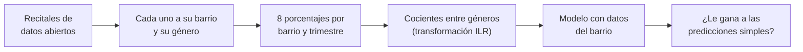
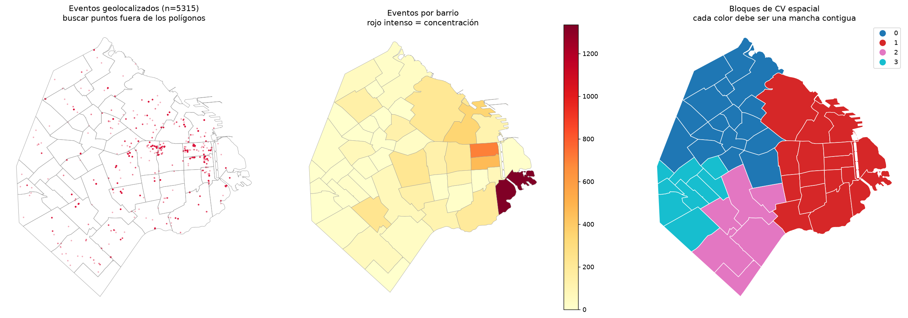

<div align="center">

# 🎶 Perfil musical de los barrios de CABA

**Un estudio para medir qué música en vivo se toca en cada barrio de Buenos Aires y si eso se explica por cómo es el barrio.**

[](https://github.com/francataldi/perfil-musical-caba/actions/workflows/tests.yml)


</div>

> **Estado: en pausa.** El diseño del estudio está cerrado, los recitales están juntados y cada uno está ubicado en su barrio (etapas 0 a 2 de 9). Lo que sigue es asignarle un género a cada recital. Todavía no hay respuesta a la pregunta.

---

## La pregunta

> **¿En qué medida la mezcla de géneros de la música en vivo de un barrio de CABA se explica por sus características demográficas, socioeconómicas y de accesibilidad?**

- **Se mide la oferta**, los recitales que pasan dentro del barrio. No lo que escuchan sus vecinos.
- **La unidad es el barrio**, no la persona. Nada de esto permite adivinar el gusto de alguien por dónde vive.
- **"Casi nada" también es una respuesta.** Si las características del barrio no explican más que las predicciones más simples, la pregunta queda respondida igual.

La pregunta, las métricas, las comparaciones y los criterios de éxito y de fracaso se escribieron y congelaron en [docs/00_protocolo.md](docs/00_protocolo.md) antes de descargar un solo dato, para que los resultados no puedan cambiar la vara con la que se los mide.

## Por qué no alcanza con contar recitales

Para cada barrio y cada trimestre, los recitales se reparten en 8 grupos de géneros: rock, tropical y urbano, folklore, tango, jazz y blues, electrónica, clásica y otros. El resultado son 8 porcentajes que suman 100%.

Eso trae una trampa: si en un barrio sube el tango, algún otro género tiene que bajar aunque nadie haya dejado de tocarlo. Las herramientas de siempre, como la correlación o el promedio, leen ese efecto como si fuera real. Por eso el análisis usa la **geometría de Aitchison**, que trabaja con cocientes entre géneros ("cuánto más tango que rock") en lugar de porcentajes sueltos.



## Lo que ya se sabe de los datos

<p align="center"></p>

- **4.550 recitales** de música entre 2018 y 2022, sacando 2020 y 2021 por la pandemia. La meta era 3.000. Salen del portal de datos abiertos de la Ciudad.
- **El 98,5% trae coordenadas**, y ubicándolos en el mapa el barrio coincide con el que declara la fuente el **97,1%** de las veces.
- **Los 30 lugares con más recitales**, que suman tres de cada cuatro, se revisaron por dos caminos distintos: a mano y con un buscador de direcciones. El 93% quedó confirmado.
- **La Usina del Arte sola tiene 1.315 de los 5.315 recitales ubicados, el 24,7%.** El "perfil musical de La Boca" es, en los hechos, la programación de un solo centro cultural. Hay que decidir cómo tratarlo antes de modelar.
- **La fuente es la programación del Ministerio de Cultura**, así que deja afuera el circuito comercial: salas como Niceto o La Trastienda, clubes, milongas privadas y peñas. Es un sesgo conocido y va a la sección de limitaciones.

## Por dónde va

| Etapa | Qué es | Estado |
|---|---|---|
| 0 | Diseño del estudio: pregunta, métricas, comparaciones y criterios | ✅ cerrada |
| 1 | Juntar los recitales | ✅ cerrada: 4.550 recitales |
| 2 | Ubicar cada recital en su barrio | ✅ cerrada: 98,5% ubicados, 43 barrios con recitales |
| 3 | Asignar un género a cada recital | la que sigue, y la más riesgosa |
| 4 | Armar la tabla barrio por trimestre | pendiente |
| 5 | Herramientas para porcentajes que suman 100% | las operaciones están programadas y probadas; faltan los gráficos |
| 6 | Datos de cada barrio | pendiente |
| 7 | Modelos | pendiente |
| 8 | Agrupar barrios parecidos | pendiente |
| 9 | Mapa interactivo y comunicación | pendiente |

El detalle de cada etapa, con sus condiciones para pasar a la siguiente, está en [ROADMAP.md](ROADMAP.md).

## Qué hay en el repo

```
docs/00_protocolo.md        pregunta, métricas, comparaciones y criterios, congelados antes de ver datos
docs/01_fuentes.md          fuentes de datos, cuánto aporta cada una y sus sesgos
docs/especificacion_v1.md   especificación técnica
src/composicional.py        operaciones con porcentajes que suman 100% (cierre, CLR, ILR, distancia de Aitchison)
src/esquema.py              formato común de un recital, venga de la fuente que venga
src/normalizacion.py        normalización de textos para comparar nombres (sin tildes ni mayúsculas)
scripts/                    descarga, ubicación en el barrio y verificación de lugares, en orden
data/interim/               recitales ubicados, mapa de control y verificación de lugares
data/processed/             grupos de barrios vecinos para validar
tests/                      65 tests; las operaciones se contrastan contra la librería composition-stats
environment.yml             entorno de conda
ROADMAP.md                  estado de cada etapa
```

## Correrlo

```bash
git clone https://github.com/francataldi/perfil-musical-caba.git
cd perfil-musical-caba
conda env create -f environment.yml
conda activate musica-caba
python -m pytest
```

## Glosario

| Término | Qué es, en criollo |
|---|---|
| **Composición** | Un conjunto de porcentajes que suman 100%, como la mezcla de géneros de un barrio. |
| **Geometría de Aitchison** | La forma de hacer cuentas con composiciones sin caer en la trampa de que todo suma 100%. |
| **CLR e ILR** | Dos maneras de convertir los porcentajes en cocientes, donde sí valen las cuentas de siempre. |
| **Distancia de Aitchison** | Qué tan distintas son las mezclas de dos barrios. |
| **Predicción simple** | La vara mínima: por ejemplo, decir que cada barrio tiene la mezcla promedio de la ciudad. |
| **Validación por grupos de barrios** | Se prueba el modelo en barrios que no vio, agrupados con sus vecinos para que no se copie de al lado. |

---

El código se puede usar libremente bajo la [licencia MIT](LICENSE).

<div align="center"><sub>Hecho por <a href="https://www.linkedin.com/in/franco-cataldi-gagliardi-2347a9268">Franco Cataldi Gagliardi</a> · también hice <a href="https://github.com/francataldi/truco-senas">agentes de truco que inventan sus propias señas</a> y <a href="https://github.com/francataldi/clima-ensambles">un pronóstico del clima global por ensambles</a></sub></div>
